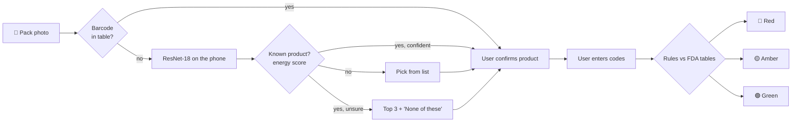

<div align="center">

# 💊 SureCure

### Snap the box. Check the codes. Know before you swallow.

*An offline Android screener for counterfeit over-the-counter medicines in the Philippines*

<br />


</div>

---

> [!IMPORTANT]
> SureCure **screens**, it doesn't certify. 🟢 Green means *"no match with FDA counterfeit records"*, never "safe" or "authentic". Anything 🟡 amber or 🔴 red should be checked with the FDA and a pharmacist.

<details>
<summary><b>📑 Contents</b></summary>

1. [The problem](#-the-problem)
2. [What SureCure does](#-what-surecure-does)
3. [Where the data comes from](#%EF%B8%8F-where-the-data-comes-from)
4. [How it works](#%EF%B8%8F-how-it-works)
5. [What we found](#-what-we-found)
6. [What went wrong, and what we did about it](#-what-went-wrong-and-what-we-did-about-it)
7. [Where it goes next](#-where-it-goes-next)
8. [Getting started](#-getting-started)
9. [Inside the repo](#%EF%B8%8F-inside-the-repo)
10. [How we built it](#-how-we-built-it)
11. [References](#-references)

</details>

---

## 🚨 The problem

A 2019 United Nations report named the Philippines a hotspot for counterfeit medicines in Southeast Asia (United Nations Office on Drugs and Crime [UNODC], 2019). It isn't abstract. The FDA keeps warning about fake versions of the brands sitting in every household cabinet: Biogesic, Bioflu, Decolgen Forte, Tuseran Forte, Alaxan FR.

Fakes are made to look right, so looking closely doesn't help much. What *does* give them away is usually written on the box: a lot number the FDA has flagged, a registration number that belongs to a different product, a barcode that doesn't match. The catch is that this evidence is buried in hundreds of advisories that ordinary buyers never read.

**Our question:** can a regular Android phone recognize a common OTC medicine from a photo, check its printed codes against FDA records offline, and stay honest about what it can't tell?

## ✨ What SureCure does

| | |
|---|---|
| 📸 **Two-photo capture** | The front of the pack, then the panel with the codes |
| 🏷️ **Barcode first** | A listed barcode identifies the product straight away |
| 🧠 **On-device recognition** | A small vision model recognizes 20 common Philippine OTC products, with no internet needed |
| 🙅 **Knows what it doesn't know** | Unfamiliar packs are flagged instead of guessed |
| 🔎 **Code check** | The barcode, lot, registration number and dates are typed next to the code-panel photo, confirmed by the user, and checked against FDA-based rules |
| 🚦 **Clear verdict** | 🔴 red, 🟡 amber or 🟢 green, always with the reasons |
| 📍 **Next step** | Amber and red results link to FDA verification and reporting, and point to nearby established drugstores |
| 🗒️ **Scan history** | Every verdict is saved on the phone, grouped by month |

## 🗂️ Where the data comes from

| Source | Used for | Size |
|---|---|---|
| Capsure: Pharmaceutical Drugs and Vitamins Dataset V2 (Vencer, 2023) | Training (synthetic composites) and testing (real photos) | 20 products, ~40k synthetic and ~11k real images |
| FDA Philippines registrations | Registration number check | 66 numbers for our brands |
| FDA counterfeit drug advisories, March 2022 to present | Counterfeit lot check | 327 product and lot pairs, 122 for our products |
| Online pharmacy listings and Open Food Facts | Barcode lookup | 18 check-digit-verified EAN-13 codes |
| Chain drugstore store locators | "Find a nearby drugstore" | 4,252 branches, checked against 2023 PSGC boundaries (Faeldon, n.d.; Philippine Statistics Authority [PSA], 2023) |
| Medical Pills dataset (Jocher & Rizwan, 2024) | Testing the out-of-scope guard on unfamiliar pills | 115 images |

Scraped files are kept untouched in `data/*/raw/`. Every cleaned table and app asset is rebuilt by a script in `scripts/`, and each data folder has a short README listing what was fixed and what's still missing.

## 🛠️ How it works



**The photo identifies the product. The codes decide the verdict.** A good fake looks like the real thing, so we never let the image model call something counterfeit.

<details>
<summary><b>🔬 The details</b></summary>

- **Recognition.** A ResNet-18 (He et al., 2016) pretrained on ImageNet (Deng et al., 2009) and trained with AdamW (Loshchilov & Hutter, 2019), exported to ONNX and run with ONNX Runtime on the phone.
- **Synthetic-only training, on purpose.** In Capsure's real photos, each product was shot in its own time slot, so lighting alone predicts the product (14.1% against 5% chance). We train on the synthetic composites and keep real photos for choosing the checkpoint, calibrating and testing.
- **No leakage.** Real photos are split by burst (shots taken seconds apart), never by frame.
- **Out-of-scope guard.** An energy score (Liu et al., 2020) with a conformal threshold (Bates et al., 2023), set so about 5% of supported photos get wrongly rejected. A rejected photo goes to the product list, not a dead end.
- **Calibrated confidence.** Temperature scaling sets how sure the model has to be before showing a single answer; below that, it shows its top 3.
- **Rules.** Red if the lot matches an FDA counterfeit advisory for that product (exact, or one character off for lots of 6+ characters), or if the codes belong to a different product. Amber if something can't be verified. Green otherwise. Every product variant (Forte, No-Drowse, ...) maps to one label, so a genuine variant is never flagged just for being a variant.
- **One source of truth.** `meta.json` carries every number the app needs (temperature, thresholds, padding colour). The app reads it instead of hard-coding values.

</details>

## 📊 What we found

Measured on real photos that were never used for training or any tuning decision, with 95% Wilson intervals (Wilson, 1927):

| | Result |
|---|---|
| 📦 **Packaging photos** (what the app asks for) | **78.0%** correct (71.5 to 83.3) |
| 🥉 Right answer within the top 3 | **89.8%** (84.6 to 93.4) |
| 🟦 Box / blister strip / loose pill | 92.8% / 56.0% / 18.3% |
| 🖼️ All real photos, any kind | 54.6% (48.9 to 60.2) |
| 💡 Lighting-only baseline (chance 5%) | 14.1% |
| ✅ When the app answers confidently | 37.5% of packaging photos, 95.2% of those correct |
| 🙅 Unknown-product guard | AUROC 0.81 on held-out products; wrongly rejects 6.4% of supported photos |
| 📱 Phone vs training preprocessing | Same answer on 93.3% of photos |

**In plain terms:** box photos work very well, loose pills don't, so the app asks for the box. When it isn't sure, the right product is almost always in its top 3. The rules engine is checked against 1,027 cases from the Python reference and 21 hand-written scenarios. For example, Biogesic lot 23651568 from FDA Advisory No. 2025-0507 (Food and Drug Administration Philippines [FDA], 2025) comes back red, and so does the same lot with one character misread.

## 🧗 What went wrong, and what we did about it

- **Synthetic to real.** 98.5% on synthetic images, much less on real ones. Stronger augmentation and AdaBN (Li et al., 2018) both made it worse, so we dropped them. Fine-tuning on our own photos of three products made the model guess those three too often; a safeguard we built rejected it automatically.
- **A guard that failed.** Our first unknown-product guard, a Mahalanobis score (Lee et al., 2018) fitted on synthetic features, scored worse than chance on outside pill photos. It was measuring image quality, not product identity. We ran a fair comparison of four options with the winner decided before the run; the energy score won. The failed version stays in the notebook as evidence.
- **Messy scraped data.** Duplicate advisories, ten spellings of one brand, placeholder lot numbers, and about 1 in 7 drugstore coordinates missing or in the wrong city. Scripts clean and log all of it and set aside 66 rows for a person to check.
- **Gaps in FDA records.** No registration was found for Myra E, Neurogen E, Rogin E, Omeprazole (generic) or DayZinc. They still get the counterfeit lot check, but top out at amber.

## 🔭 Where it goes next

- 🔁 **Learn from real use:** barcode-confirmed scans (opt-in) become new training photos taken on real phones.
- 🔄 **Live FDA updates** with the advisory number and link shown on every red result.
- 🗺️ **Spot outbreaks:** opt-in reports grouped by municipality, shown only once there are at least 5, could tell the FDA where a fake lot is spreading.
- ➕ **More products:** adding one means synthetic images, a few real photos and its FDA rows.

## 🚀 Getting started

**You'll need** Android Studio (recent stable), an Android 7.0+ phone or emulator, and Python 3 if you want to rebuild data or rerun the model.

```bash
git clone <this repository>
cd SureCure
```

**Run the app.** Open the folder in Android Studio, let Gradle sync, press ▶️. The model and all tables are bundled, so it works offline.

**Run the tests**

```bash
./gradlew :app:testDebugUnitTest          # preprocessing, rules, parity with Python, scan flow, drugstores
./gradlew :app:connectedDebugAndroidTest  # golden images: phone must match the notebook
pytest -q rules/tests                     # Python reference rules
```

**Rebuild the data**

```bash
python scripts/build_fda_tables.py         # FDA tables from data/fda/raw
python scripts/build_drugstore_asset.py    # the app's drugstore list
```

**Reproduce the model numbers.** Open `ml/surecure_train.ipynb` on Kaggle or Colab with a T4 GPU and attach the Capsure dataset. Full training takes about 2 hours. To re-score our released weights instead, attach them and run `import os; os.environ["SC_EVAL_WEIGHTS"] = "auto"` before the config cell (about 20 minutes). Results land in `surecure_outputs.zip`.

## 🗃️ Inside the repo

```
App/                     Android app (Kotlin, Jetpack Compose)
├─ src/main/assets/        model (onnx + meta + labels), FDA tables, drugstore list
├─ src/main/java/…/ml/     preprocessing + on-device classifier
├─ src/main/java/…/rules/  rules engine, FDA table loading, barcode lookup
├─ src/main/java/…/ui/     camera, result, nearby drugstores, dashboard
└─ src/test, androidTest   unit, parity and golden-image tests
ml/                      training + evaluation notebook and its generator
rules/                   Python reference rules + test scenarios
data/                    FDA and drugstore data (raw + cleaned)
scripts/                 rebuild tables, assets and test fixtures
docs/                    model card, data sources, integration notes
med-images/              team photos used in the fine-tuning experiment
```

**Dependencies.** App: Kotlin, Jetpack Compose, Navigation Compose, CameraX, ONNX Runtime for Android (pinned in `gradle/libs.versions.toml` and `App/build.gradle.kts`). Notebook: PyTorch, torchvision, scikit-learn, SciPy, pandas, Pillow, onnxruntime. Data scripts: pandas, NumPy, matplotlib. Weights, datasets and run outputs stay out of git.

## 🤝 How we built it

<p>
  
  
  
</p>

This project used **AI-assisted programming with human review the whole way through.** Claude helped draft code, the notebook, the data-cleaning scripts and these docs. Gemini worked as a second pair of eyes that could inspect the code but never change it. Nothing went in without a team member reading it, running it and checking the result.

What the AI couldn't do for us was the **systems thinking**, and that's where most of our time went. SureCure isn't one model; it's a chain: camera → barcode → model → guard → user confirmation → rules → FDA tables → verdict → next step. A weak link anywhere breaks the whole thing, so we designed each piece around the others:

- 🔗 **Contracts between parts.** The model, the app and the notebook share one `meta.json`, and golden test images prove the phone gives the same answer as the training code.
- 🧯 **Failure paths, not just happy paths.** Every stage has a fallback (unknown pack → product list, unsure → top 3, missing code → amber), so a user never hits a dead end.
- ⚖️ **Who decides what.** The photo only identifies the product; the printed codes decide the verdict. That split came from asking how a counterfeiter would beat each part.
- 🔁 **A loop, not a one-off.** Data scripts rebuild every table, tests check every rule against the Python reference, and confirmed scans can feed future training.

The calls that matter were ours: what data to trust, what counts as red, amber or green, and how to read the results. When the AI got something wrong, we fixed it and kept the record, which is why the failed experiments are still in the notebook.

## 📚 References

<details>
<summary>Show all references (APA 7th edition)</summary>

<br />

Bates, S., Candès, E., Lei, L., Romano, Y., & Sesia, M. (2023). Testing for outliers with conformal p-values. *The Annals of Statistics, 51*(1), 149–178. https://doi.org/10.1214/22-AOS2244

Deng, J., Dong, W., Socher, R., Li, L.-J., Li, K., & Fei-Fei, L. (2009). ImageNet: A large-scale hierarchical image database. In *2009 IEEE Conference on Computer Vision and Pattern Recognition* (pp. 248–255). IEEE. https://doi.org/10.1109/CVPR.2009.5206848

Faeldon, J. (n.d.). *philippines-json-maps* [Data set]. GitHub. Retrieved October 24, 2026, from https://github.com/faeldon/philippines-json-maps

Food and Drug Administration Philippines. (2025). *FDA Advisory No. 2025-0507: Public health warning against the purchase and use of the counterfeit drug product Paracetamol (Biogesic) 500 mg tablet*. https://www.fda.gov.ph/fda-advisory-no-2025-0507-public-health-warning-against-the-purchase-and-use-of-the-counterfeit-drug-product-paracetamol-biogesic-500-mg-tablet-lot-no-23651568-expiry-date-mar/

He, K., Zhang, X., Ren, S., & Sun, J. (2016). Deep residual learning for image recognition. In *2016 IEEE Conference on Computer Vision and Pattern Recognition* (pp. 770–778). IEEE. https://doi.org/10.1109/CVPR.2016.90

Jocher, G., & Rizwan, M. (2024). *Ultralytics datasets: Medical-pills detection dataset* (Version 1.0.0) [Data set]. Ultralytics. https://docs.ultralytics.com/datasets/detect/medical-pills/

Lee, K., Lee, K., Lee, H., & Shin, J. (2018). A simple unified framework for detecting out-of-distribution samples and adversarial attacks. *Advances in Neural Information Processing Systems, 31*, 7167–7177. https://proceedings.neurips.cc/paper/2018/hash/abdeb6f575ac5c6676b747bca8d09cc2-Abstract.html

Li, Y., Wang, N., Shi, J., Hou, X., & Liu, J. (2018). Adaptive batch normalization for practical domain adaptation. *Pattern Recognition, 80*, 109–117. https://doi.org/10.1016/j.patcog.2018.03.005

Liu, W., Wang, X., Owens, J. D., & Li, Y. (2020). Energy-based out-of-distribution detection. *Advances in Neural Information Processing Systems, 33*, 21464–21475. https://proceedings.neurips.cc/paper/2020/hash/f5496252609c43eb8a3d147ab9b9c006-Abstract.html

Loshchilov, I., & Hutter, F. (2019). *Decoupled weight decay regularization* [Conference paper]. International Conference on Learning Representations, New Orleans, LA, United States. https://openreview.net/forum?id=Bkg6RiCqY7

Philippine Statistics Authority. (2023). *Philippine Standard Geographic Code (PSGC)* [Data set]. https://psa.gov.ph/classification/psgc

United Nations Office on Drugs and Crime. (2019). *Transnational organized crime in Southeast Asia: Evolution, growth and impact*. https://www.unodc.org/roseap/en/2019/07/transnational-organised-crime-southeast-asia-report-launch/story.html

Vencer, L. (2023). *Pharmaceutical drugs and vitamins dataset V2* [Data set]. Kaggle. https://www.kaggle.com/datasets/vencerlanz09/pharmaceutical-drugs-and-vitamins-dataset-v2

Wilson, E. B. (1927). Probable inference, the law of succession, and statistical inference. *Journal of the American Statistical Association, 22*(158), 209–212. https://doi.org/10.1080/01621459.1927.10502953

Store locators of the five chains and the FDA registration and advisory sources are listed in `docs/data_sources.md`. Method references for the notebook are at the end of `ml/surecure_train.ipynb`.

</details>
